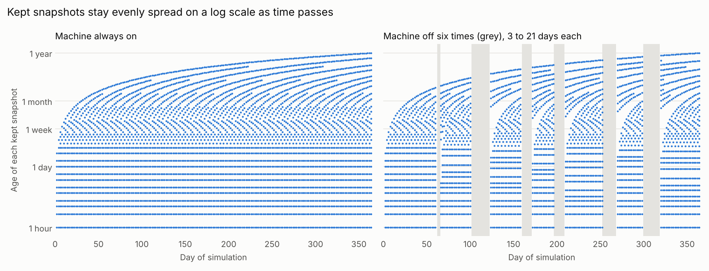

# snapshot-thinning

Proof of concept for logarithmic ("Fibonacci-like") snapshot retention, written
for [openSUSE/snapper#962](https://github.com/openSUSE/snapper/issues/962).
It is independent of snapper: the input is a list of creation times.

## The problem with exact Fibonacci ages

Snapshots cannot sit at ages 1, 2, 3, 5, 8, 13, 21 hours. Three hours later the
same snapshots are 4, 5, 6, 8, 11, 16, 24 hours old, and snapshots that were
never taken (machine off) cannot be created afterwards.

## The rule

Do not ask for snapshots at particular ages. Only remove the ones that are
redundant:

> Walk from the newest snapshot to the oldest. Delete a snapshot when its older
> neighbour is at most `ratio` times as old as its newer neighbour.
> Never delete the newest or the oldest snapshot.

`ratio` defaults to the golden ratio 1.618, the growth rate of the Fibonacci
sequence. The whole algorithm is one pass over the sorted list
([`thinning.py`](thinning.py), about 20 lines of logic).

One cleanup over a year of hourly snapshots keeps these ages in hours:

    0 1 2 3 4 6 9 14 22 35 56 90 145 234 378 611 988 1598 2585 4182 6766 8759

From 2 onwards that is the Fibonacci sequence plus one, up to 6766. The last
entry is the oldest snapshot, which is always kept.

## What the testsuite shows

`pytest -q` runs 19 tests, most of them property-based (hypothesis).

| Property | Result |
|---|---|
| Only existing snapshots are deleted; nothing is ever required to exist | holds for arbitrary input |
| Newest and oldest snapshot are never deleted | holds |
| A second cleanup at the same moment deletes nothing | holds |
| No redundant snapshot is left after a cleanup | holds |
| Neighbours are at most `ratio` apart in age, unless no snapshot was ever created between them | holds for arbitrary creation times and arbitrary cleanup schedules |
| Number of kept snapshots is at most `2 * log_ratio(oldest age / youngest age) + 4` | holds |
| Hourly snapshots: 29 kept after 1 year, 35 after 10 years | measured |

The gap bound keeps holding as time passes because ages grow by the same
amount, which only moves the ratio of two ages closer to 1.

## Known limits

**Cleanup frequency changes which snapshots survive, not how they are spaced.**
With hourly, daily, weekly or one single cleanup over the same year, 22 to 29
snapshots survive and the guarantees above hold in every case, but any
two schedules share only 6 to 12 individual snapshots.

**Age is wall-clock time, so a long downtime thins the recent history at once.**
Two weeks on, three weeks off: before shutdown 19 snapshots are kept (ages 0,
1, 2, 3, 4, 5, 7, 11, ... hours). At the first cleanup after boot 16 of them
are deleted and 4 remain (ages 0, 505, 776, 840 hours). The last snapshot
before shutdown always survives; the hourly detail before it does not.
snapper's current count-based limits behave differently here.

`keep_newest=N` softens this: the N newest snapshots are never deleted. With
`keep_newest=10` the nine hours before shutdown survive the boot and are
thinned over the following hours as new snapshots arrive.

**The oldest snapshot is kept forever.** A real implementation would want a
maximum age or a maximum count.

## Simulation

`python3 simulate.py` prints the table below and writes `simulation.png`.
One year of hourly snapshots, `ratio` = 1.618:

| Scenario | Kept | Widest gap older than 1 day | Most deleted by one cleanup |
|---|---|---|---|
| always on, cleanup hourly | 29 | 1.58x | 2 |
| always on, cleanup daily | 27 | 1.59x | 25 |
| always on, cleanup weekly | 27 | 1.50x | 169 |
| always on, one cleanup after a year | 22 | 1.62x | 8738 |
| 6 off-periods of 3 to 21 days, cleanup hourly | 28 | 1.58x | 19 |
| same, `keep_newest=10` | 32 | 1.56x | 14 |



Each dot is one kept snapshot, sampled every two days (the newest snapshot,
age 0, is not shown on the log axis).

## Usage

```python
from thinning import thin

keep, delete = thin(times, now)                    # creation times, any unit
keep, delete = thin(times, now, ratio=2.0, min_age=1800, keep_newest=10)
```

Requirements: Python 3.8+, `pytest` and `hypothesis` for the tests,
`matplotlib` for the plot.
